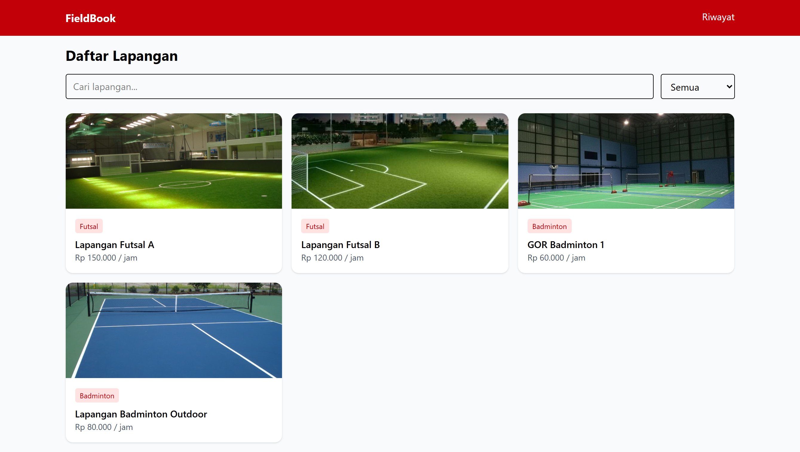
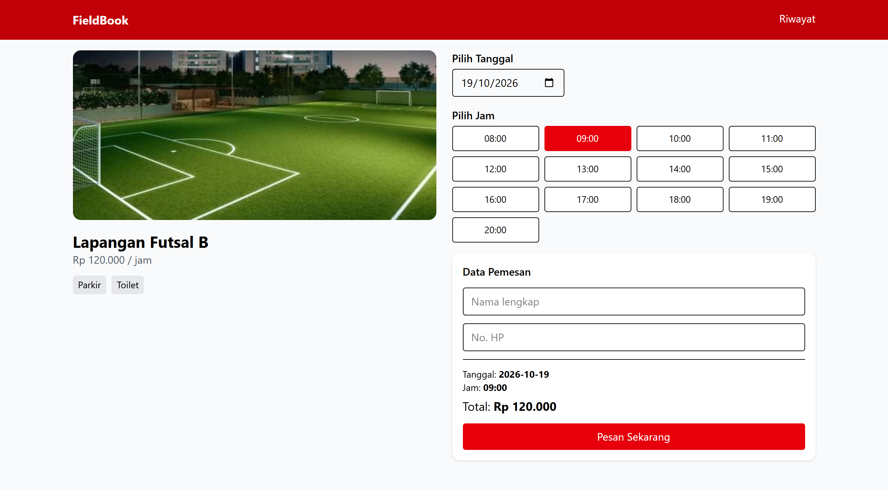
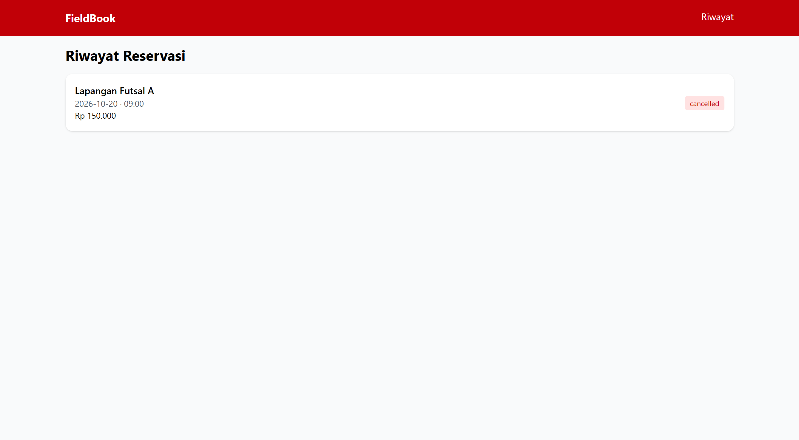

# FieldBook – Sports Field Reservation (React)

A responsive frontend for booking sports fields (futsal, badminton, basketball). Users can browse fields, pick a date and time slots, and manage their reservations.

This is the React version of my Laravel project: [field_reservation](https://github.com/hanira-bee/field_reservation).

🔗 **Live demo:** [field-reservation-react](https://field-reservation-react-vert.vercel.app/)

## Screenshots

| Fields list | Field detail & booking | Reservation history |
|---|---|---|
|  |  |  |

## Features

- **Browse fields** with search by name and filter by sport type
- **Field detail** page with photo, price per hour, and facilities
- **Date and time-slot picker**: already-booked slots are disabled
- **Booking form** with validation and automatic total price calculation
- **Reservation history** with status (confirmed / cancelled) and cancel action
- Data persists in the browser via `localStorage` (no backend required)
- Responsive layout (mobile and desktop)

## Tech Stack

- [React](https://react.dev/) + [Vite](https://vite.dev/)
- [React Router](https://reactrouter.com/) for client-side routing
- [Tailwind CSS](https://tailwindcss.com/) for styling
- Custom hook (`useBookings`) for state and `localStorage` persistence

## Project Structure

```
src/
├── assets/        # field images
├── components/    # Navbar, FieldCard, SlotPicker, BookingForm
├── data/          # dummy field data and time slots
├── hooks/         # useBookings (state + localStorage)
├── pages/         # FieldsPage, FieldDetailPage, HistoryPage
├── App.jsx
└── main.jsx
```

## Getting Started

```bash
git clone https://github.com/hanira-bee/field-reservation-react.git
cd field-reservation-react
npm install
npm run dev
```

Then open the address shown in the terminal (usually `http://localhost:5173`).

## Build for Production

```bash
npm run build
npm run preview
```

## Notes

This project uses mock data and `localStorage` instead of a real backend. The Laravel version contains the full-stack implementation (authentication, admin dashboard, MySQL).

## Author

**Hanira** – [GitHub](https://github.com/hanira-bee)